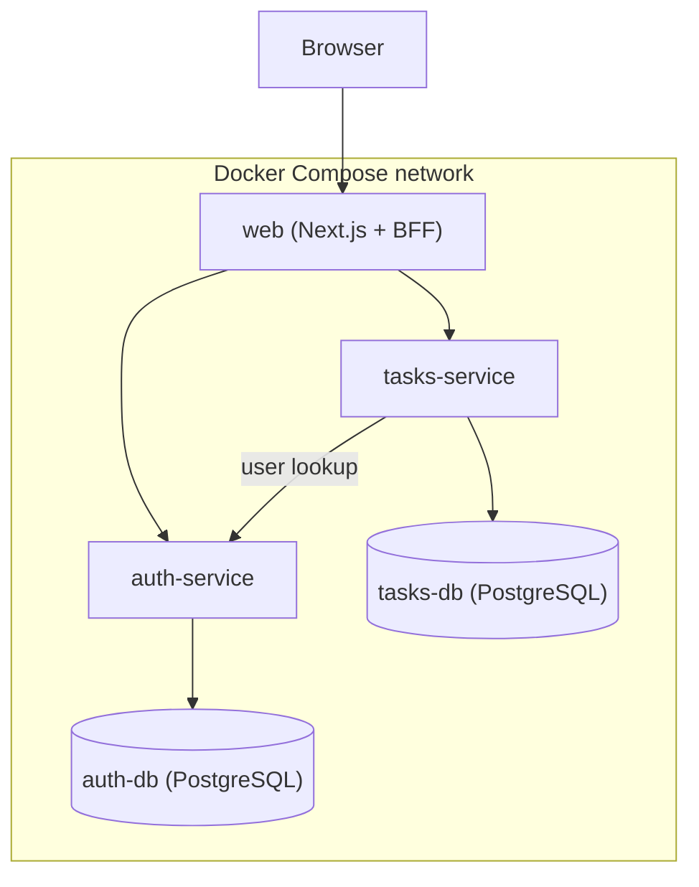
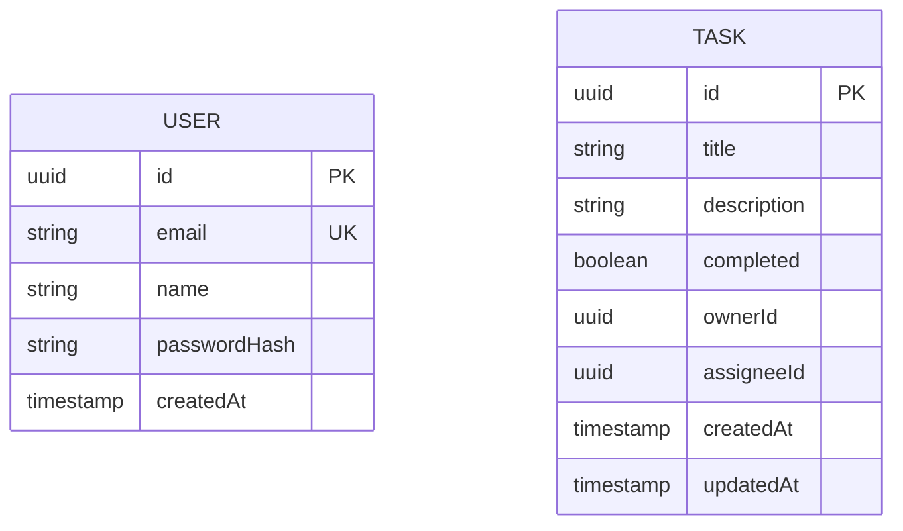
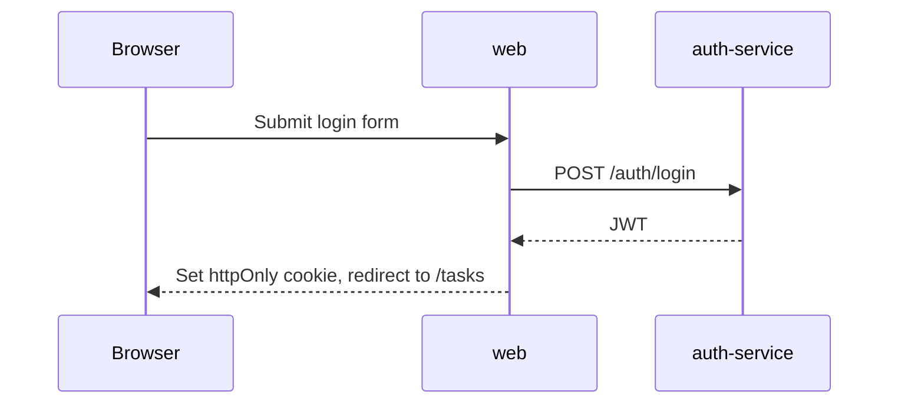
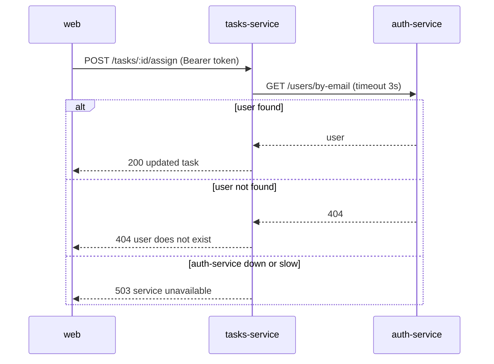

# Architecture

This document records what each component does, how components talk to each other and why each decision was made. Update it whenever a decision changes.

> **Note:** this describes the target architecture. Tasklane is being built incrementally, so some components are not implemented yet. The [README](README.md) tracks the current status.

## Overview

## Components

### web (Next.js)

- Renders the login, sign-up and task pages.
- Acts as a backend-for-frontend (BFF): Route Handlers or Server Actions call the services from the Next.js server, never from the browser.
- Stores the JWT in an `httpOnly` cookie and forwards it as `Authorization: Bearer <token>` to the services.
- Uses internal service URLs (`http://auth-service:3001`, `http://tasks-service:3002`) that only exist inside the Docker network.

### auth-service (NestJS)

- Owns users. Nobody else reads or writes `auth-db`.
- Hashes passwords with bcrypt and issues JWTs signed with `JWT_SECRET`.

| Method | Route | Description |
|---|---|---|
| POST | `/auth/register` | Create a user (409 if the email exists) |
| POST | `/auth/login` | Return a JWT (401 on invalid credentials) |
| GET | `/auth/me` | Return the user from the token |
| GET | `/users/by-email?email=` | Look up a user, used by `tasks-service` (404 if not found) |
| GET | `/health` | Health check |

### tasks-service (NestJS)

- Owns tasks. Nobody else reads or writes `tasks-db`.
- Validates the JWT locally with the shared `JWT_SECRET` (no call to `auth-service` per request).
- Calls `auth-service` only to resolve an email when assigning a task.

| Method | Route | Description |
|---|---|---|
| GET | `/tasks` | Tasks owned by or assigned to the current user |
| POST | `/tasks` | Create a task |
| PATCH | `/tasks/:id` | Edit a task |
| PATCH | `/tasks/:id/complete` | Mark a task as completed |
| DELETE | `/tasks/:id` | Delete a task (owner only) |
| POST | `/tasks/:id/assign` | Assign a task to a user by email |
| GET | `/health` | Health check |

## Data model

`ownerId` and `assigneeId` reference users by id, but there is no foreign key: users live in a different database. Keeping that reference valid is the responsibility of the code, which is a normal trade-off of the database-per-service pattern.

## Request flows

### Log in

### Assign a task by email

## Configuration

All configuration comes from environment variables defined in `.env` (copied from `.env.example`).

| Variable | Used by | Purpose |
|---|---|---|
| `JWT_SECRET` | auth-service, tasks-service | Signs and verifies tokens |
| `AUTH_DB_*` | auth-service, auth-db | Connection to `auth-db` |
| `TASKS_DB_*` | tasks-service, tasks-db | Connection to `tasks-db` |
| `AUTH_SERVICE_URL` | tasks-service, web | Internal URL of `auth-service` |
| `TASKS_SERVICE_URL` | web | Internal URL of `tasks-service` |

## Decisions

| Decision | Reason |
|---|---|
| Two backend services | Minimum needed to practise service boundaries, inter-service calls and separate data without repeating work. |
| Database per service | Each service owns its data; others must ask through its API. |
| Next.js as BFF instead of an API gateway | The browser talks to a single origin, tokens stay in an `httpOnly` cookie, and there is one less component to learn in seven days. |
| HTTP only, no message broker | Keeps the communication model easy to trace and debug; async messaging is a later step. |
| TypeORM | Official NestJS integration, reinforces modules and dependency injection. |
| Local JWT verification in tasks-service | Avoids calling `auth-service` on every request. |
| Docker Compose with healthchecks | One command starts everything, in the right order, on any machine. |
